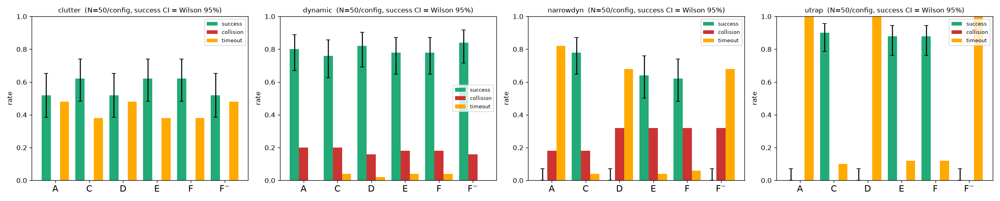
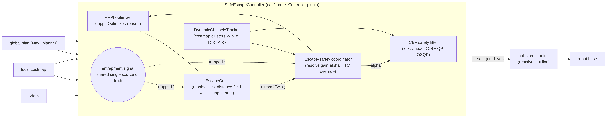
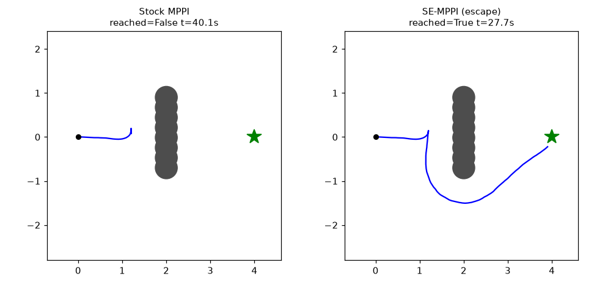
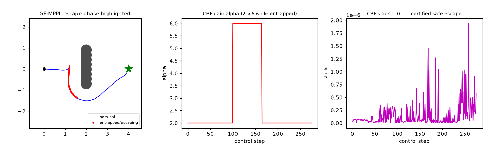
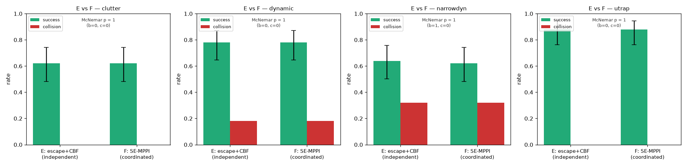

# SE-MPPI

**A Nav2 controller plugin that integrates online local-minima
detection-and-escape for MPPI with a control-barrier-function safety filter for
tracked dynamic obstacles.**

Jungmo Kang · [kangjmo91@gmail.com](mailto:kangjmo91@gmail.com)

[](https://github.com/kjungmo/se-mppi-nav2/actions/workflows/ci.yml)
[](https://docs.ros.org/en/jazzy/)
[](https://docs.nav2.org/)
[](LICENSE)
[-6f42c1)](docs/papers/arxiv_ref/main.pdf)
[](https://github.com/sponsors/kjungmo)

<p align="center">
  
</p>

<p align="center"><em>Randomized 1,200-trial benchmark on a Python 2D mirror of the controller's
primitives, not on the Nav2 controller (Wilson 95% error bars on success, N = 50 per cell).
On the trap families the detect-and-switch escape configs (C, E, F) separate from the
mirror's plain MPPI (A), CBF-only (D), and no-gap (F⁻), which time out at 0% success.</em></p>

---

## Menu

- [Overview](#overview)
- [System architecture](#system-architecture)
- [Features](#features)
- [Requirements](#requirements)
- [Affected nav2_mppi_controller builds](#affected-nav2_mppi_controller-builds)
- [Install and build](#install-and-build)
- [Quick start](#quick-start)
- [Benchmark artifacts](#benchmark-artifacts)
- [Evaluation gallery](#evaluation-gallery)
- [Paper and citation](#paper-and-citation)
- [Documentation](#documentation)
- [Acknowledgements](#acknowledgements)
- [Sponsor](#-sponsor)
- [License](#license)

## Overview

The MPPI controller shipped with ROS 2 Nav2 is a widely used deployable local
controller for mobile robots, yet in narrow, cluttered and dynamic spaces it can
stall in local minima, and its critics avoid collisions only through soft costs.
**SE-MPPI** (Safe-Escape MPPI) is a Nav2 controller plugin that integrates online
local-minima detection-and-escape for MPPI with a control-barrier-function (CBF)
safety filter for tracked dynamic obstacles. One path-progress entrapment signal
switches repulsion and free-space gap costs into the MPPI rollouts and, through a
coordinator, raises the barrier's class-𝒦 gain. Each ingredient has precedent;
what this repository adds is their integration inside one Nav2 controller. This
repository is the code, data and manuscript of a **preprint**.

What is measured and what is not:

- **Measured, in a Python 2D mirror of the controller's primitives (not the Nav2
  controller):** in a randomized, paired 1,200-trial benchmark the
  detection-and-escape layer lifts success from **0% to 88–90%** on a static
  U-trap family and from **0% to 62–78%** on a narrow-dynamic family, and
  disabling the mirror's free-space gap subgoal returns both to 0%.
- **Null:** the escape–safety coordination is statistically indistinguishable
  from an independent escape+CBF stack (McNemar p = 1 in every family). It is
  claimed as a mechanism, not as an empirical gain.
- **Conditional, not a certificate:** by a standard argument for time-varying CBF
  gains the gain schedule keeps the barrier's safe set forward invariant, but
  only for a look-ahead point and the tracked dynamic obstacles, assuming the
  barrier inequality holds between control updates and the QP uses no slack. In
  the benchmark the QP uses slack at least once in most trials with moving
  obstacles.
- **Live Nav2 + Gazebo:** see [Live runs](#live-runs) below.

## System architecture

<p align="center">
  
</p>

The `SafeEscapeController` subclasses the stock MPPI controller and post-processes
its nominal command each cycle. A **shared entrapment signal** (derived from
furthest-reached global-path progress) drives both the sampling-time
`EscapeCritic` and the output-time escape–safety coordinator; the coordinator
resolves the CBF gain α (with a time-to-collision override), and the CBF safety
filter — fed by the `DynamicObstacleTracker` — projects the command onto the
CBF-safe set via a small QP before it reaches `cmd_vel`, which Nav2's
`collision_monitor` guards as a final reactive layer. The escape and safety
layers thus act at complementary points, unified by one entrapment signal and the
coordinated gain.

## Features

1. **Nav2-native controller plugin.** `SafeEscapeController` ships as a
   `nav2_core::Controller` plus a pluginlib MPPI critic (`EscapeCritic` in the
   `mppi::critics` namespace), reusing the stock MPPI optimizer for the nominal
   command.
2. **Detect-and-switch local-minima escape.** Entrapment is declared when the
   furthest-reached path index stalls; the `EscapeCritic` then injects
   distance-field APF and free-space gap-attraction costs **only while trapped**,
   so free-space behavior is unchanged.
3. **Look-ahead-point CBF safety filter (OSQP).** A per-cycle CBF-QP on tracked
   dynamic obstacles (static structure is left to MPPI's cost critic) filters the
   nominal `(v, ω)`; on a failed or relaxed barrier it brakes forward velocity.
   The barrier acts on a look-ahead point, not on the robot body.
4. **Escape–safety coordination.** The coordinator raises the CBF class-𝒦 gain
   on detected entrapment (α_base → α_escape) with a time-to-collision override.
   Forward invariance under such a schedule is a known result for time-varying
   gains; the paper restates it as a conditional lemma (slack-free QP, barrier
   inequality assumed between samples). No outcome benefit of the coordination
   was measured.
5. **82 C++ unit tests across 13 files** (gtest) plus linters, covering the
   entrapment detector, CBF filter, coordinator, tracker, gap search, repulsion,
   path progress, and plugin loading. These are the algorithm unit tests in
   `src/nav2_se_controller/test/test_*.cpp`, the count the paper cites.
   Deployment tests live separately in `src/nav2_se_controller/test/deployment/`
   (the controller on a lifecycle node inside the stock MPPI optimizer, runtime
   parameter changes, `/diagnostics`).
   The benchmark data were generated at tag `paper-v1` (commit b21b0a5); the
   Python mirror that produced them is unchanged since. The paper describes the
   C++ controller at the commit of the live re-run (recorded in every
   `experiments/results_pilot_rerun/trials/*/meta.json`), which adds the rollout
   guard, 55 deployment tests in 6 files (`test/deployment/`) and fixes to the
   controller of `paper-v1`.
6. **Committed benchmark artifacts.** The 1,200-trial randomized 2D benchmark
   ships its raw per-trial CSV, summary, statistics, tables, and figures; a
   number guard (`scripts/check_paper_numbers.py`) asserts that every headline
   figure quoted in the paper traces to a committed artifact.
7. **Gazebo U-trap testbed + live Nav2 integration.** A committed testbed
   (`experiments/se_mppi_utrap/`) and a one-command sim launcher run the
   controller inside a live ROS 2 Jazzy + Nav2 + Gazebo Harmonic stack.
   *Note, 2026-10-11:* the live runs committed so far (`experiments/results_pilot/`,
   July 2026) were made on a `nav2_mppi_controller` build with flipped rollouts
   (see [Affected nav2_mppi_controller builds](#affected-nav2_mppi_controller-builds),
   PR #6). Whether that caused their outcome is not established; they have not
   been repeated on a corrected build.

## Requirements

Installed reproducibly via **RoboStack** (conda-forge + `robostack-jazzy`), so the
build does not depend on the host OS version (validated on Ubuntu 20.04 with an
NVIDIA GPU). The setup script (`scripts/setup_ros2_env.sh`) provisions:

- **ROS 2 Jazzy** (`ros-jazzy-ros-base`)
- **Nav2** — `navigation2`, `nav2-bringup`, `nav2-mppi-controller`,
  `nav2-minimal-tb3-sim`, `nav2-simple-commander`
- **Gazebo Harmonic** + `ros-gz`, and **RViz 2** (for the live sim)
- **OSQP** — `osqp-eigen`, `eigen` (the CBF-QP)
- **Toolchain** — `colcon-common-extensions`, `cxx-compiler`, `cmake`, `ninja`,
  `pkg-config`

A GPU workstation is recommended: the live Gazebo stack needs hardware rendering.

**ROS 2 Humble.** The controller also builds and passes its unit, deployment and
lint tests on Humble (Nav2 1.1.x, `nav2_mppi_controller` 1.1.20), checked in CI
with the RoboStack environment in
[`.github/environment-humble.yml`](.github/environment-humble.yml). What differs
on Humble (compile-time switch `NAV2_SE_CONTROLLER_HUMBLE_API`):

- Humble's `controller_server` never calls the controller's `reset()`. A plan to
  a new goal, or to the same goal after the control loop was idle longer than
  `se_task_idle_threshold`, starts a new task and resets the per-task state, so
  a new task still starts clean; `reset()`'s own clearing (on goal end or
  cancel) does not happen.
- The escape critic's gap search needs a goal bearing. Humble's `CriticData` has
  no goal, so it uses the end of the pruned local path (MPPI's path window), not
  the navigation goal. On a curved or long path the two can point in different directions, so
  the gap choice is not equivalent to Jazzy's.
- **SE-MPPI's control performance on Humble's MPPI 1.1.x has not been
  evaluated**: every reported result comes from the Jazzy stack or the 2D
  benchmark.
- **The RoboStack Humble `nav2_mppi_controller` binary is affected by the defect
  below, and no corrected Humble binary exists.** The controller refuses to
  configure on it. CI builds `nav2_mppi_controller` 1.1.20 from source without
  `-ffast-math` and tests on that.
- Humble's MPPI 1.1.20 is not reproducible run to run with the stock critic
  stack: the same binary, inputs and noise seed gave 2 distinct command
  sequences in 8 runs (7 in 8 in an independent repetition), and one sequence in
  8 of 8 runs once `PathAlignCritic` alone is removed. This is upstream
  behaviour that predates the guard; its root cause is unknown. Jazzy 1.3.13
  gave one sequence in every run.

See [`RUN.md`](RUN.md) for the full run guide and troubleshooting.

## Affected nav2_mppi_controller builds

> **Warning.** Some distributed `nav2_mppi_controller` binaries roll sampled
> trajectories out in the wrong direction. A controller built on them, stock
> MPPI or SE-MPPI, commands motion **away from the goal**. Check your library
> before you drive a robot.

**Defect.** The MPPI optimizer scores each sampled control sequence at the
positions its batch integration computes. The affected binaries negate cos/sin
in that integration for part of the heading range: cos for |yaw| < π/4 and sin
for |yaw| < 3π/4 (yaw in the costmap frame); beyond 3π/4 the rollout is exact.
The optimizer then sees its samples at mirrored positions. This is a build
defect of the binary, not of Nav2's source: upstream report
[RoboStack/ros-jazzy#290](https://github.com/RoboStack/ros-jazzy/issues/290),
"[linux-64] MPPI 1.3.12 predicts motion in the wrong direction due to stale
build dependency (xsimd / fast-math)" (closed 2026-10-10), which states: "The
suspected cause is the interaction between fast-math and xsimd's use of
positive/negative zero as sign masks. Removing `-ffast-math` or appending
`-fsigned-zeros` restores the expected numerical results."

**Symptom.** With a goal straight ahead and reversing allowed (`vx_min` < 0) the
robot backs away from the goal, up to `vx_min`. With `vx_min` ≥ 0 it does not
reverse; it creeps at `vx_min`. Headings beyond 3π/4 drive correctly, so the
fault comes and goes with the heading. Nothing crashes and every command is
finite.

| Distribution | Package build | State | Basis |
|---|---|---|---|
| Humble | `ros-humble-nav2-mppi-controller 1.1.20 np2py312h2ed9cc7_18` (robostack-staging) | **affected** | measured (CI: the direction test fails on it) |
| Humble | `ros2-nav2-mppi-controller 1.1.20 np2py314h53a0733_20` (robostack-staging) | **affected** | measured (`check_mppi_rollout`, 2026-10-11) |
| Jazzy | `ros-jazzy-nav2-mppi-controller 1.3.11 np2py312h2ed9cc7_16` (robostack-jazzy) | **affected** | measured (direction test and `check_mppi_rollout`, 2026-10-11) |
| Jazzy | `ros2-nav2-mppi-controller 1.3.12 np2py312h2ed9cc7_21` | **affected** | reported in the upstream issue; not run here |
| Jazzy | `ros2-nav2-mppi-controller 1.3.12 np2py312h84585a2_22` | corrected per upstream | its conda recipe removes `-ffast-math`; not run here |
| Jazzy | `ros2-nav2-mppi-controller 1.3.13 np2py312h405a742_25` (mutex `jazzy_25`) | **correct** | measured; the build CI is pinned to |

Other sources (apt binaries, your own source build) were not tested; the check
below tells.

**How to check.** After building this package:

```bash
ros2 run nav2_se_controller check_mppi_rollout
```

It asks the `nav2_mppi_controller` library this package loads for a set of known
rollouts (16 start headings, each straight and through a full left and right
turn; 24,576 points) and compares them with the closed form. It prints the
library's path and exits with status 0 if every point is within 1 mm (a correct
library is within 1e-6 m), and with status 1 and the measurement otherwise.
It needs no node, costmap or TF. To see which build is installed without
building anything: `micromamba list nav2-mppi-controller` (the build string is
the third column).

**What the controller does.** `SafeEscapeController` runs the same check at every
`configure`, before it creates anything:

| Library | `se_enforce_rollout_check` | `configure` | Log | `/diagnostics` |
|---|---|---|---|---|
| passes the check | `true` or `false` | proceeds, unchanged | nothing | key `mppi_rollout_check: ok`; level as before |
| fails the check | `true` (default) | throws: the configure transition fails. **Restart the process** after the fix; a second configure aborts it (below) | one ERROR: loaded library, measurement, known cause and builds, remedy, the override | none (the node never activates) |
| fails the check | `false` | proceeds | one ERROR at each configure | ERROR every second while active; keys `mppi_rollout_check: failed`, `mppi_rollout_detail` |

**After a refusal, restart `controller_server`.** The lifecycle state reads
`unconfigured` after the failed transition, but Nav2's `controller_server` cannot
configure a second time: it has already added its costmap node to an executor, and
the second attempt ends with `terminate called after throwing an instance of
'std::runtime_error'  what(): Node '/local_costmap/local_costmap' has already been
added to an executor.` and `[ros2run]: Aborted` (reproduced on Humble 1.1.20 and
Jazzy 1.3.11). That is how the server treats any controller plugin that throws
from `configure`; the plugin cannot repair it from inside. So fix the library, or
put `se_enforce_rollout_check: false` in the parameter file, and start the
process again.

The check uses its own throwaway optimizer object, so on a library that passes
it changes no command (compared bit for bit with the previous commit over 120
closed-loop cycles on Jazzy 1.3.13). `se_enforce_rollout_check` is read at
configure only; a runtime set is rejected. It is an override for someone who has
to look at an affected stack, not a setting for a robot that moves. Limits: the check covers
the batch rollout integration, the known defect, not every function of the
library; and it lives in `SafeEscapeController`, so an `EscapeCritic` loaded
into a stock `nav2_mppi_controller::MPPIController` is not guarded.

**Remedy.**

- *Jazzy:* use `nav2_mppi_controller` 1.3.13 build `_25` or later. All ROS
  packages of a RoboStack environment share one `ros2-distro-mutex`, so this
  means the `jazzy_25` package set, i.e. a new environment:
  `micromamba create -n <name> -f .github/environment-jazzy.yml` gives the
  pinned CI set, and a fresh `scripts/setup_ros2_env.sh` resolves to the same
  MPPI build (dry run, 2026-10-11). An environment that
  `scripts/setup_ros2_env.sh` created earlier keeps its old build: the script
  skips an existing environment.
- *Humble:* build `nav2_mppi_controller` from source without `-ffast-math`, in
  the workspace you build this package in:

  ```bash
  scripts/build_mppi_overlay.sh ws          # upstream 1.1.20, -ffast-math removed
  ln -s "$PWD/src/nav2_se_controller" ws/src/
  (cd ws && colcon build --packages-select nav2_se_controller \
     --cmake-args -DNAV2_SE_CONTROLLER_MPPI_RPATH=ON)
  source ws/install/setup.bash
  ros2 run nav2_se_controller check_mppi_rollout   # must print OK and the path under ws/
  ```

  `-DNAV2_SE_CONTROLLER_MPPI_RPATH=ON` (default `OFF`) is needed here. The conda
  toolchain gives every binary it links, this package's included, a `DT_RPATH` to
  `<environment>/lib`, and the loader searches a `DT_RPATH` before
  `LD_LIBRARY_PATH`. So without the option the plugin is compiled against the
  overlay but loads the environment's (affected) `libmppi_controller.so` at run
  time, sourced overlay or not. The option puts the overlay's `lib` directory
  first on that RPATH. What that means:

  - the entry takes precedence over `LD_LIBRARY_PATH` for this package's binaries;
  - the install is tied to the overlay's absolute path: it is not relocatable and
    not fit for a binary package, which is why the option is off by default (a
    default build adds nothing to the RPATH the toolchain writes);
  - if the overlay is moved or deleted, the loader falls back to the next entry,
    the environment's library, without a message. The rollout check then refuses
    that library and names it;
  - an executable of your own that links `libmppi_controller.so` directly
    resolves it with its own RPATH, not with this one.

  Measured on the Humble environment (`readelf -d`, `LD_DEBUG=libs`,
  `check_mppi_rollout`), package built against the overlay:

  | Option | Overlay | RPATH of the package's binaries | Library loaded | Check |
  |---|---|---|---|---|
  | `ON` | present | `<ws>/install/nav2_mppi_controller/lib:<env>/lib` | overlay | OK |
  | `ON` | moved away | same | `<env>/lib` (stock) | FAILED, exit 1 |
  | `OFF` | present, sourced | `<env>/lib` | `<env>/lib` (stock) | FAILED, exit 1 |
  | `OFF` | moved away | `<env>/lib` | `<env>/lib` (stock) | FAILED, exit 1 |

  With `OFF` and an overlay CMake prints a warning that the library it found is
  not on the RPATH.

## Install and build

```bash
git clone https://github.com/kjungmo/se-mppi-nav2.git && cd se-mppi-nav2
bash scripts/setup_ros2_env.sh
```

Activate the environment, then build and test (from
[`HANDOFF.md`](HANDOFF.md) §2):

```bash
export MAMBA_ROOT_PREFIX=$HOME/micromamba
eval "$($HOME/.local/bin/micromamba shell hook -s bash)"
micromamba activate ros2

colcon build --packages-select nav2_se_controller
colcon test --packages-select nav2_se_controller && colcon test-result --verbose
```

> The `setup_ros2_env.sh` script prints the exact activation commands for your
> environment on exit (root/container prefixes differ from the local non-root
> prefix shown above).

### Continuous integration

[`.github/workflows/ci.yml`](.github/workflows/ci.yml) runs on every push to
`main` and every pull request, in a minimal RoboStack Jazzy environment pinned in
[`.github/environment-jazzy.yml`](.github/environment-jazzy.yml):

- build `nav2_se_controller`, then `colcon test` (algorithm unit tests,
  deployment tests, linters). The deployment tests include
  `test_rollout_direction`: the installed `libmppi_controller`'s batch rollout
  against the closed form, the sign of the controller's command for a goal ahead
  and behind at 15 headings, and the configure-time guard;
- `scripts/check_simd_abi.py`: `libescape_critic` and `libmppi_rollout_check`
  must use the same xtensor storage type as the `libmppi_controller` they run
  with (see the ABI note at the top of `src/nav2_se_controller/CMakeLists.txt`);
- `scripts/check_param_binding.py`: `controller_server` is lifecycle-configured
  headless with `config/nav2_se_controller_params.yaml` and
  `experiments/sim/nav2_se_loopback.yaml`, and every `FollowPath.*` key must be
  declared and hold the YAML value (a few keys in the experiment YAML are known to
  be unread and listed in the workflow; an injected unknown key must fail);
- the deployment tests again under AddressSanitizer;
- a Humble job (`.github/environment-humble.yml`). Its environment holds the
  affected stock binary. The job first proves the defect and the guard on it
  (the direction test must fail on the rollout and command-sign cases,
  `check_mppi_rollout` must exit 1, `controller_server` must refuse to
  configure, and must configure with one ERROR under
  `se_enforce_rollout_check: false`), then builds `nav2_mppi_controller` 1.1.20
  from source without `-ffast-math` (`scripts/build_mppi_overlay.sh`) and runs
  the build, the tests, the ABI check and the parameter-binding check on the
  shipped YAML against that;
- `scripts/check_paper_numbers.py` (default mode).

The lint tests include cppcheck: CI sets `AMENT_CPPCHECK_ALLOW_SLOW_VERSIONS=1`,
without which `ament_cppcheck` skips cppcheck 2.x and reports its cases as skipped.

To reproduce the CI jobs locally (from the repository root):

```bash
micromamba create -y -n se_ci -f .github/environment-jazzy.yml
# For the Humble job, use .github/environment-humble.yml instead, build the
# MPPI overlay first (the stock Humble binary is refused; see "Affected
# nav2_mppi_controller builds"):  scripts/build_mppi_overlay.sh ws
# and add  --cmake-args -DNAV2_SE_CONTROLLER_MPPI_RPATH=ON  to the colcon build.
# In the ABI guard below, --mppi is then ws/install/nav2_mppi_controller/lib/libmppi_*.so
micromamba activate se_ci
export AMENT_CPPCHECK_ALLOW_SLOW_VERSIONS=1
mkdir -p ws/src && ln -s "$PWD/src/nav2_se_controller" ws/src/
(cd ws && colcon build --packages-select nav2_se_controller \
  && colcon test --packages-select nav2_se_controller \
  && colcon test-result --verbose --test-result-base build/nav2_se_controller)

# ABI guard
python3 scripts/check_simd_abi.py \
  --mppi "$CONDA_PREFIX/lib/libmppi_controller.so" "$CONDA_PREFIX/lib/libmppi_critics.so" \
  --critic ws/install/nav2_se_controller/lib/libescape_critic.so \
           ws/install/nav2_se_controller/lib/libmppi_rollout_check.so

# Rollout direction of the MPPI library this build loads (exit status 0 = correct)
source ws/install/setup.bash
ros2 run nav2_se_controller check_mppi_rollout

# Parameter binding (headless controller_server, lifecycle configure), as in CI.
# The Humble job runs only the shipped YAML and the negative fixture.
source ws/install/setup.bash
check() {  # check <yaml> [script args...]
  ros2 run nav2_controller controller_server --ros-args --params-file "$1" &
  python3 scripts/check_param_binding.py "$@" --configure; rc=$?
  kill %1; wait; return $rc
}
check src/nav2_se_controller/config/nav2_se_controller_params.yaml
check experiments/sim/nav2_se_loopback.yaml \
  --allow-unread FollowPath.TwirlingCritic.enabled \
  --allow-unread FollowPath.TwirlingCritic.twirling_cost_power \
  --allow-unread FollowPath.TwirlingCritic.twirling_cost_weight \
  --allow-unread FollowPath.AckermannConstraints.min_turning_r \
  --allow-unread FollowPath.verbose
# Negative fixture: must fail with "NOT DECLARED ... FollowPath.se_not_a_parameter"
sed 's/^      se_enabled: true$/      se_enabled: true\n      se_not_a_parameter: 1.0/' \
  src/nav2_se_controller/config/nav2_se_controller_params.yaml > /tmp/bogus.yaml
check /tmp/bogus.yaml && echo "UNEXPECTED PASS"

# AddressSanitizer build of the deployment tests (separate workspace)
mkdir -p ws_asan/src && ln -s "$PWD/src/nav2_se_controller" ws_asan/src/
(cd ws_asan && colcon build --packages-select nav2_se_controller --cmake-args \
  "-DCMAKE_CXX_FLAGS=-fsanitize=address -fno-omit-frame-pointer -DEIGEN_MALLOC_ALREADY_ALIGNED=1" \
  "-DCMAKE_SHARED_LINKER_FLAGS=-fsanitize=address" "-DCMAKE_EXE_LINKER_FLAGS=-fsanitize=address" \
  && source install/setup.bash \
  && export ASAN_OPTIONS=detect_stack_use_after_return=1:detect_leaks=0:new_delete_type_mismatch=0:alloc_dealloc_mismatch=0 \
  && for t in test_controller_runtime test_controller_behaviour test_escape_critic_params test_rollout_direction; do ./build/nav2_se_controller/$t || exit 1; done)

python3 scripts/check_paper_numbers.py
```

### Runtime parameters and diagnostics

Runtime-settable (`ros2 param set /controller_server FollowPath.se_alpha_base 3.0`);
the new value reaches its consumer before the next control cycle:

- controller: `se_enabled`, `se_goal_reached_tolerance`,
  `se_dynamic_speed_threshold`, `se_max_obstacle_radius`, `se_task_idle_threshold`;
- entrapment detector: `se_progress_stall_window`;
- coordinator: `se_alpha_base` (also the CBF filter's default gain),
  `se_alpha_escape`, `se_ttc_override_threshold`, `se_q_trust_threshold`;
- CBF filter: `se_cbf_lookahead`, `se_cbf_safety_margin`, `se_cbf_slack_weight`,
  `se_cbf_robot_radius`;
- tracker: `se_obstacle_cost_threshold`, `se_obstacle_min_cells`,
  `se_obstacle_association_gate`, `se_obstacle_max_speed`, `se_classify_static`,
  `se_static_min_frames`, `se_static_fraction`, `se_predict_horizon`,
  `se_track_history`, `se_track_max_missed`, `se_predict_model`, `se_conformal`,
  `se_tracker_stale_grid_timeout` (the learned conformal bounds are kept);
- tracker, restarting the conformal calibration from `se_conformal_initial_q`
  (logged as a warning): `se_predict_steps`, `se_predict_dt`,
  `se_conformal_coverage`, `se_conformal_lr`, `se_conformal_initial_q`,
  `se_conformal_max_q`;
- multi-robot (only declared when `se_multirobot` is true): `se_priority_id`,
  `se_neighbor_match_radius`, `se_reciprocal_lambda`, `se_pass_lambda`,
  `se_yield_lambda`, `se_deadlock_range`, `se_deadlock_speed`, `se_yield_v_max`.

Configure-only (a runtime set is rejected with a reason; change them while the
`controller_server` is unconfigured, then configure): `se_multirobot`, `se_viz`,
`se_neighbor_odom_topics`, `se_enforce_rollout_check` (default `true`; see
[Affected nav2_mppi_controller builds](#affected-nav2_mppi_controller-builds):
after a refusal it has to be changed in the parameter file and the process
restarted, because `controller_server` cannot configure again after a failed
configure).

The CBF filter's velocity box follows MPPI's `vx_max`, `wz_max` and
`min(vx_min, 0)`, scaled by Nav2's speed limit (`setSpeedLimit`, as MPPI scales its
own limits); its disc radius is the footprint's circumscribed radius unless
`se_cbf_robot_radius` > 0. Path progress is measured in the plan's frame (the
robot pose is transformed with the latest plan-to-costmap transform). A replan to
the same goal (same frame, endpoint within two costmap cells) keeps the stall count
and obstacle tracks, unless the control loop was idle for longer than
`se_task_idle_threshold` (at least three control periods): then it is a new task
and the per-task state resets, on every distribution. The tracker advances once
per local-costmap update, so `se_static_min_frames`, `se_track_history` and
`se_track_max_missed` count costmap updates; a grid that stays identical for longer
than `se_tracker_stale_grid_timeout` (default two costmap update periods) is fed
to the tracker anyway, so a frozen costmap never keeps an old velocity in the
CBF. Known limit of that rule: an obstacle that changes cells less often than
`se_tracker_stale_grid_timeout` (about 0.11 m/s at 0.05 m cells and a 5 Hz
costmap) drops out of the CBF on about 9 % of cycles (the repeated grid reads
zero velocity until the next cell change), and in between its speed is
over-estimated (measured mean 0.17 m/s, max 0.33 m/s against a true 0.11 m/s;
`ControllerCostmapRate.SlowMoverIsInTheCbfMoreOftenThanBefore`). That is
conservative but can cause extra braking.

The controller publishes a status `"<node name>: se_mppi (<plugin name>)"` on
`/diagnostics` once per second (wall clock). It turns WARN when the CBF filter
forced the forward velocity to zero in the last second (QP failure or barrier
slack), and ERROR when the QP has failed on every cycle for more than 2 s (40
cycles at Nav2's default 20 Hz, inside the default 10 s progress-checker
allowance). It carries counters for those events, dropped obstacle tracks, escape
entries and the current alpha. The same events are logged as throttled warnings.
The key `mppi_rollout_check` is `ok`, or `failed` when the loaded
`nav2_mppi_controller` library failed the configure-time rollout check and
`se_enforce_rollout_check` is `false`; the status is then ERROR for as long as the
controller is active, whatever the other counters say (with the default `true`
the controller does not configure, so there is no status).
The status name uses the node name, not its namespace (`hardware_id` holds the
namespace): in a multi-robot setup, namespace or remap `/diagnostics` per robot,
or read `hardware_id`, to tell the robots apart.

## Quick start

**Run the controller in a live Gazebo + Nav2 stack** (one command; builds if
needed, launches Gazebo + Nav2 + RViz):

```bash
bash scripts/run_sim.sh                 # GUI sim + RViz, you click the goal
bash scripts/run_sim.sh --drive         # + auto initial pose & goal (smoke)
bash scripts/run_sim.sh --headless      # no GUI (CI / remote)
```

**Register the plugin in your own Nav2 stack** by setting the
`controller_server`'s `FollowPath` plugin to
`nav2_se_controller::SafeEscapeController` and merging the `se_*` keys and the
`EscapeCritic` entry from the fully-commented sample parameter file:
[`src/nav2_se_controller/config/nav2_se_controller_params.yaml`](src/nav2_se_controller/config/nav2_se_controller_params.yaml).

**Validate the mechanisms without a simulator** (pure-Python 2D; generates the
mechanism figures):

```bash
cd experiments/prototype && python3 run_validation.py
```

## Benchmark artifacts

The controlled quantitative comparison is a **randomized benchmark on a Python
2D mirror of the controller's primitives**: a separate NumPy/SciPy/OSQP
implementation of an MPPI sampler, a repulsive potential, a gap raycast, the
look-ahead-point CBF-QP, the α coordination with TTC override, and a
monotone-progress entrapment detector, run on seed-deterministic randomized
scenarios so that success carries confidence intervals and paired tests. It is
**not** the Nav2 controller, and it differs from it in documented ways (the
paper's appendix lists them: distance-to-goal progress instead of a path, the
gap used as a temporary subgoal, analytic circular geometry, a summed potential,
a three-term cost instead of Nav2's critic stack, true obstacle states). It
imports nothing from ROS or Nav2, so the `nav2_mppi_controller` defect described
above cannot affect it. A full-scale 3D physics benchmark (BARN / DynaBARN /
HuNavSim against the deployable baselines) is specified but not run.

The benchmark needs only Python with NumPy, SciPy, Matplotlib and OSQP, which
`scripts/setup_ros2_env.sh` does not install:
`python3 -m pip install -r experiments/requirements.txt` (any Python
environment; ROS is not needed).

**Regenerate** (from
[`docs/papers/2026_2d-benchmark-results.md`](docs/papers/2026_2d-benchmark-results.md);
the committed data uses `N=50`):

```bash
python3 -m experiments.benchmark2d.runner \
    --families utrap clutter dynamic narrowdyn -n <N> --workers 6 --max-steps 400
python3 -m experiments.benchmark2d.report      # tables + stats
python3 -c "from experiments.benchmark2d import figures, aggregate; \
    r=aggregate.aggregate('experiments/results_2d/trials.csv','experiments/results_2d'); \
    figures.plot_all(r['summary'], r['stats'], 'experiments/results_2d/figures')"
```

**Success rate, % (Wilson 95% CI), N = 50 per cell** — condensed from
[`experiments/results_2d/tables.md`](experiments/results_2d/tables.md)
(4 families × 50 seeds × 6 configs = 1,200 paired trials):

| Config | U-trap | Clutter | Dynamic | Narrow-dyn |
|---|---|---|---|---|
| A · stock            | 0 [0, 7]    | 52 [39, 65] | 80 [67, 89] | 0 [0, 7]    |
| C · escape           | 90 [79, 96] | 62 [48, 74] | 76 [63, 86] | 78 [65, 87] |
| D · CBF              | 0 [0, 7]    | 52 [39, 65] | 82 [69, 90] | 0 [0, 7]    |
| E · escape+CBF (indep.) | 88 [76, 94] | 62 [48, 74] | 78 [65, 87] | 64 [50, 76] |
| **F · SE-MPPI (coord.)** | **88 [76, 94]** | **62 [48, 74]** | **78 [65, 87]** | **62 [48, 74]** |
| F⁻ · no-gap          | 0 [0, 7]    | 52 [39, 65] | 84 [71, 92] | 0 [0, 7]    |

In the mirror the escape layer is decisive on both trap families and survives
Holm correction (U-trap 0% → 88–90%, adjusted p = 1.4×10⁻⁹; narrow-dynamic
0% → 62–78%, adjusted p = 1.1×10⁻⁶), and F⁻ collapsing to 0% shows that the
mirror's free-space gap subgoal is load-bearing (the C++ critic's gap cost has
not been ablated). The **key E-vs-F contrast (independent vs. coordinated α) is
null in every family** (McNemar p = 1): in this benchmark the coordination
produces no measurable outcome difference over independent escape+CBF, which we
report as an honest null and delimit where coordination should matter.

## Evaluation gallery

| Finite-wall escape (mechanism, 2D mirror) | Escape–safety coordination (2D mirror) | Coordination contrast E vs. F (2D mirror) |
|---|---|---|
|  |  |  |
| The mirror's plain MPPI stalls in front of a finite wall while the escape layer detects the stall and rounds the wall via the gap subgoal. | During the escape phase the coordinated gain rises α: 2 → 6 while the QP slack stays below 2×10⁻⁶ — the escape is admitted without relaxing the barrier in this single run. | The independent (E) and coordinated (F) stacks are statistically indistinguishable in every family (McNemar p = 1): a null result. |

## Paper and citation

The manuscript is a preprint: **"SE-MPPI: Coordinating Online Local-Minima
Escape with Control-Barrier-Function Safety in a Nav2-Native Controller."** The
submission version is [`docs/papers/arxiv_ref/main.pdf`](docs/papers/arxiv_ref/main.pdf)
(source in [`docs/papers/arxiv_ref/`](docs/papers/arxiv_ref/)); a shorter two-column
copy with the same claims and numbers is
[`docs/papers/latex/main.pdf`](docs/papers/latex/main.pdf).

If you use SE-MPPI in your research, please cite:

```bibtex
@misc{kang2026semppi,
  title  = {{SE-MPPI}: Coordinating Online Local-Minima Escape with
            Control-Barrier-Function Safety in a {Nav2}-Native Controller},
  author = {Kang, Jungmo},
  year   = {2026},
  note   = {Preprint. Manuscript and artifacts at
            https://github.com/kjungmo/se-mppi-nav2},
  howpublished = {\url{https://github.com/kjungmo/se-mppi-nav2}}
}
```

Machine-readable metadata is in [`CITATION.cff`](CITATION.cff).

## Documentation

| Document | Contents |
|---|---|
| [`docs/papers/arxiv_ref/main.pdf`](docs/papers/arxiv_ref/main.pdf) | The preprint (PDF, submission version); [`docs/papers/latex/main.pdf`](docs/papers/latex/main.pdf) is the two-column copy. |
| [`experiments/results_pilot_rerun/`](experiments/results_pilot_rerun/) | Live Nav2 + Gazebo re-run: pre-registration, raw trials, analysis. |
| [`docs/papers/2026_2d-benchmark-results.md`](docs/papers/2026_2d-benchmark-results.md) | Randomized 2D benchmark write-up (methodology, tables, interpretation). |
| [`docs/papers/references.bib`](docs/papers/references.bib) · [`docs/papers/reference-verification-report.md`](docs/papers/reference-verification-report.md) | Verified bibliography and its verification report. |
| [`docs/architecture/2026-06_safe-escape-mppi-design.md`](docs/architecture/2026-06_safe-escape-mppi-design.md) | Controller architecture and module design. |
| [`docs/architecture/2026-06_se-mppi-evaluation-protocol.md`](docs/architecture/2026-06_se-mppi-evaluation-protocol.md) | Evaluation protocol, metrics, and ablation definitions. |
| [`docs/research/2026-06_safe-escape-mppi-problem-statement.md`](docs/research/2026-06_safe-escape-mppi-problem-statement.md) · [`docs/research/2026-06_se-mppi-novelty-verification.md`](docs/research/2026-06_se-mppi-novelty-verification.md) | Problem statement / prior work and the novelty verification. |
| [`experiments/README.md`](experiments/README.md) · [`experiments/runner/README.md`](experiments/runner/README.md) | Evaluation layout and the turnkey harness. |
| [`src/nav2_se_controller/config/nav2_se_controller_params.yaml`](src/nav2_se_controller/config/nav2_se_controller_params.yaml) | Fully-commented sample parameter set. |
| [`RUN.md`](RUN.md) | Local-machine run guide (Gazebo sim → real robot) with troubleshooting. |
| [`HANDOFF.md`](HANDOFF.md) | Korean development handoff (build/test cheat-sheet, status, next milestones). |

## Acknowledgements

SE-MPPI builds directly on the [ROS 2 Nav2](https://docs.nav2.org/) stack and its
`nav2_mppi_controller`, whose critic-plugin interface makes an entrapment-aware
escape critic possible without forking the optimizer. The CBF-QP is solved with
[OSQP](https://osqp.org/) via `osqp-eigen`, and the build is provisioned by
[RoboStack](https://robostack.github.io/).

## 💛 Sponsor

If SE-MPPI saves you time, consider
[sponsoring](https://github.com/sponsors/kjungmo). Sponsorship funds
maintenance, new features, and faster issue response. Backers will be
acknowledged here — thank you.

## License

Licensed under the Apache License, Version 2.0 — see [`LICENSE`](LICENSE).
